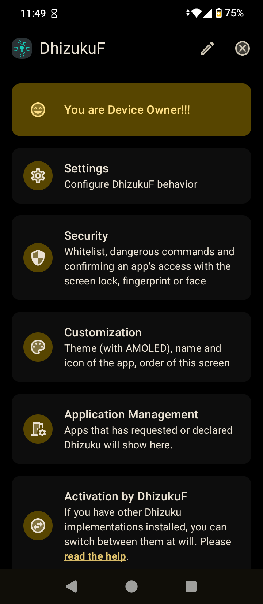
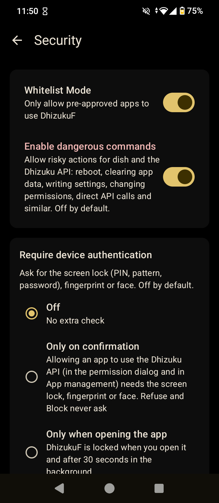
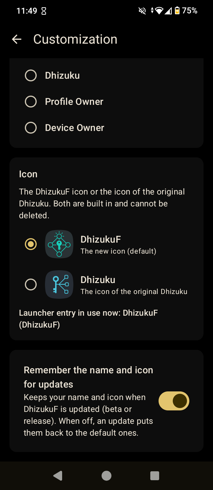
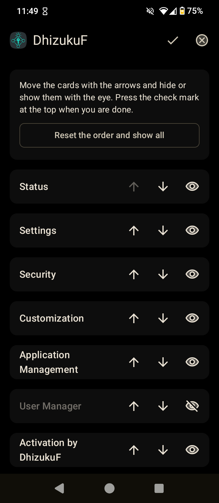
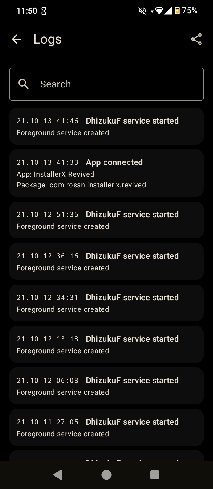

# DhizukuF

**DhizukuF** is a fork of [Dhizuku](https://github.com/iamr0s/Dhizuku) that shares Android **Device Owner** permissions with other apps. It also adds **`dish`** — a Device Owner shell for Termux, `adb shell`, and other terminals (similar to `rish` for Shizuku).

| | |
| --- | --- |
| Package | `com.EdS.DhizukuF` |
| Version | See [`version.properties`](version.properties) |
| Android | 8.0+ |
| License | [GNU GPL v3](LICENSE) |

> [!NOTE]
> Unofficial fork — not affiliated with the original Dhizuku project.
> Upstream README: [docs/README_ORIGINAL.md](docs/README_ORIGINAL.md).

## Screenshots

  
  
  
  
  

## Features

- **dish** — Device Owner commands from any shell ([docs/DISH.md](docs/DISH.md))
- **App control** — hide, suspend, permissions, restrictions, and more
- **Security** — whitelist, dangerous-commands switch, optional biometrics
- **Customization** — theme, app name/icon, home card order
- **Android TV** — banner and D-pad friendly UI

Full history: [CHANGELOG.md](CHANGELOG.md).

## Download

| Source | Link |
| --- | --- |
| **Uptodown** | [dhizukuf.en.uptodown.com](https://dhizukuf.en.uptodown.com/android) |
| **GitHub Releases** | [Latest](https://github.com/AmakerGame/DhizukuF/releases/latest) |

## Quick start

1. Make DhizukuF the **Device Owner** (or Profile Owner where supported).
2. Open **Terminal (dish)** → **Export dish files**.
3. Run `dish` / `help` from Termux or `adb shell`.
4. Approve the first connection in DhizukuF if asked.

More detail: [docs/DISH.md](docs/DISH.md).

## Documentation

| Topic | Doc |
| --- | --- |
| dish terminal | [docs/DISH.md](docs/DISH.md) |
| Building from source | [docs/BUILDING.md](docs/BUILDING.md) |
| Customization | [docs/CUSTOMIZATION.md](docs/CUSTOMIZATION.md) |
| Security & logs | [docs/LOGS.md](docs/LOGS.md) |
| Hub (compat) | [docs/HUB.md](docs/HUB.md) |
| Privacy | [docs/PRIVACY.md](docs/PRIVACY.md) |
| Terms | [docs/TERMS.md](docs/TERMS.md) |
| Donate | [docs/DONATE.md](docs/DONATE.md) |

## Links

- [Original Dhizuku](https://github.com/iamr0s/Dhizuku)
- [Dhizuku API](https://github.com/iamr0s/Dhizuku-API)
