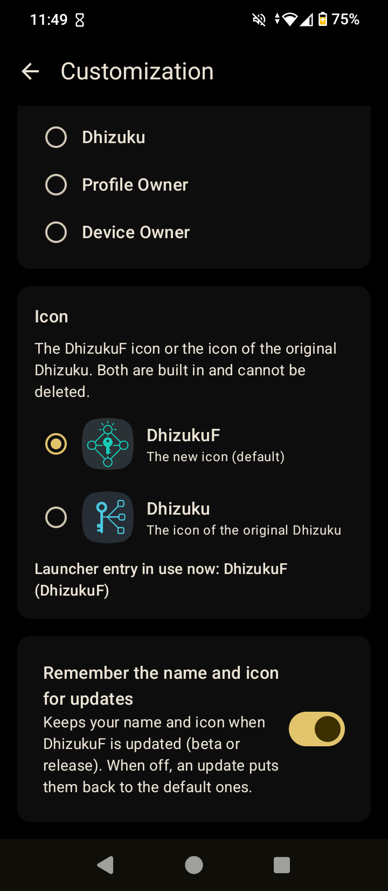
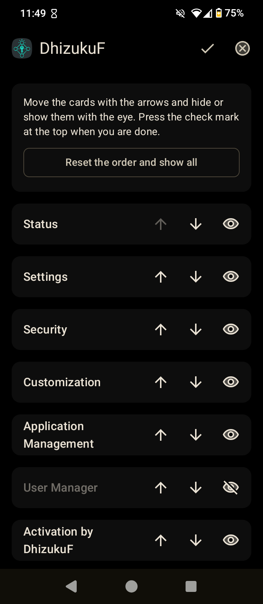
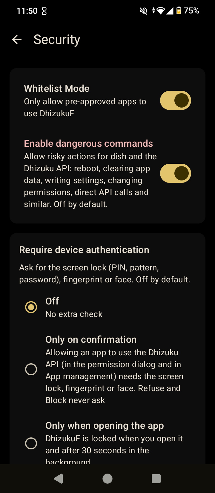

# DhizukuF

[](https://github.com/AmakerGame/DhizukuF/releases)
[](https://github.com/AmakerGame/DhizukuF/releases/latest)
[](LICENSE)
[](https://github.com/AmakerGame/DhizukuF/actions)

**DhizukuF** is a fork of [Dhizuku](https://github.com/iamr0s/Dhizuku) that shares Android **Device Owner** permissions with other apps. On top of upstream Dhizuku, it adds **`dish`** — a Device Owner console for any terminal (Termux, `adb shell`, or any shell app), similar to how `rish` works for Shizuku.

| | |
| --- | --- |
| Package | `com.EdS.DhizukuF` |
| Version | See [`version.properties`](version.properties) |
| Android | 8.0 and newer |
| License | [GNU GPL v3](LICENSE) |

> [!NOTE]
> This is an unofficial fork. It is not affiliated with the original Dhizuku project or its author.
> The original README is kept as [docs/README_ORIGINAL.md](docs/README_ORIGINAL.md).

## Features

Compared to upstream Dhizuku (full list in [CHANGELOG.md](CHANGELOG.md)):

- **dish terminal** — run Device Owner commands from any shell. Export two files from the *Terminal (dish)* card and use them anywhere. See [docs/DISH.md](docs/DISH.md).
- **~50 dish commands** — apps (hide, suspend, block uninstall, permissions, clear data), restrictions, camera, screen capture, keyguard, ADB, private DNS, settings, and more.
- **Direct API** — `dish api METHOD ARGS…` calls public `DevicePolicyManager` methods (and other system managers) by name, with typed arguments and no rebuild.
- **Clear answers** — every command ends with `OK: …` or `NOT DONE: …` and a reason; changes are verified by reading values back.
- **Device Owner / Profile Owner aware** — dish works in both modes; commands that need full Device Owner say so clearly in Profile Owner mode.
- **Dangerous commands off by default** — a Settings switch gates risky actions for dish and the Dhizuku API.
- **Android TV** — launcher banner, D-pad / remote navigation with a visible focus indicator.
- **Compatibility Hub** — optional companion APK so clients built for the original Dhizuku package can talk to DhizukuF.
- **Customization** — theme (including AMOLED), app name and icon (chosen independently), “remember for updates”, and a pencil on the home screen to reorder or hide cards. See [docs/CUSTOMIZATION.md](docs/CUSTOMIZATION.md).
- **Logs** (off by default) — journal of service events, permissions, commands and errors, with search, categories, size limit and text export. See [docs/LOGS.md](docs/LOGS.md).
- **Safe start** — dish checks access before the interactive prompt; if dish is off, DhizukuF is not Device Owner, or access is refused, the console does not start.
- **Enable dish** — independent of **Enable Dhizuku** in Settings.
- **Terminal approval** — terminals appear in *App management* (e.g. `Termux (dish)`); optional advanced confirmation with Block, and *Show dish* label.

## Screenshots

<!-- All sources are 720×1650; same width keeps them equal on GitHub. -->
<p align="center">

&nbsp;

&nbsp;

&nbsp;

&nbsp;

</p>

<p align="center"><sub>Home · Customization · Edit home · Security · Logs</sub></p>

## Quick start

1. Make DhizukuF the **Device Owner**. Upstream guide: [Dhizuku activation tutorial](https://github.com/iamr0s/Dhizuku/discussions/19).

   > [!IMPORTANT]
   > Set the device up **without accounts**, or remove them before activating.

2. Open DhizukuF → **Terminal (dish)** → **Export dish files**. You get `dish` and `dish_dhizukuf.dex` — keep them together.

3. Run from a terminal:

   ```sh
   # Termux
   cp /sdcard/<folder>/dish* "$PREFIX/bin/" && chmod +x "$PREFIX/bin/dish"
   dish
   ```

   ```text
   dish$ help
   dish$ hide com.example.app
   OK: com.example.app is now hidden
   dish$ restriction add no_install_apps
   OK: restriction no_install_apps is now active
   dish$ api setCameraDisabled true
   OK: dpm.setCameraDisabled called (no return value)
   ```

4. The first run opens an approval window in DhizukuF. Allow once; later block or revoke in **App management**.

Commands, `api` syntax and dex rebuild: [docs/DISH.md](docs/DISH.md).

## Download

Builds are on the [Releases](https://github.com/AmakerGame/DhizukuF/releases) page.

## Building

```sh
./gradlew assembleRelease
```

The dish client (`dish-client/src`: `DishMain`, `DishShell`, `DishConnection`, `DishProtocol`) is plain Java with no dependencies. Rebuild the prebuilt dex with:

```sh
./dish-client/build.sh
```

Details: [docs/DISH.md — Rebuilding the dex](docs/DISH.md#rebuilding-the-dex).

## Repository layout

| Path | Contents |
| --- | --- |
| `app/` | Android app (Kotlin, Jetpack Compose) |
| `app/src/main/java/…/dish/` | dish server: commands, engine, approval, registry |
| `app/src/main/assets/` | `dish` launcher and `dish_dhizukuf.dex` |
| `dish-client/` | Java client sources and `build.sh` |
| `hidden-api/` | Hidden Android API stubs |
| `hub/` | Compatibility Hub APK |
| `docs/` | Guides, original README, translations, terms, privacy |
| `screenshots/` | README screenshots |

## Documentation

- [dish guide](docs/DISH.md)
- [Customization](docs/CUSTOMIZATION.md)
- [Logs](docs/LOGS.md)
- [Changelog](CHANGELOG.md)
- [Security](SECURITY.md)
- [Original Dhizuku README](docs/README_ORIGINAL.md)
- [Terms of Use](docs/TERMS.md) · [Privacy Policy](docs/PRIVACY.md)

## Maintainer

Maintained by [@AmakerGame](https://github.com/AmakerGame).  
Bug reports and ideas: [open an issue](https://github.com/AmakerGame/DhizukuF/issues).

## Credits

- **Dhizuku Compatibility Hub** idea — [@Jozinho-netizen](https://github.com/Jozinho-netizen)
- [Dhizuku](https://github.com/iamr0s/Dhizuku) by iamr0s and contributors — base of this fork
- [Dhizuku-API](https://github.com/iamr0s/Dhizuku-API) for app developers
- dish idea follows [Shizuku](https://github.com/RikkaApps/Shizuku)’s `rish`

## License

Licensed under the [**GNU General Public License v3**](LICENSE), like the original project.
