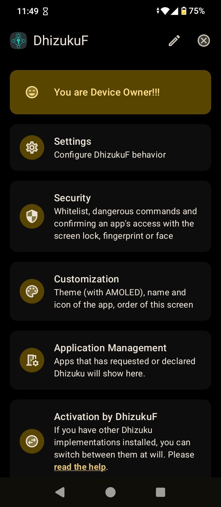
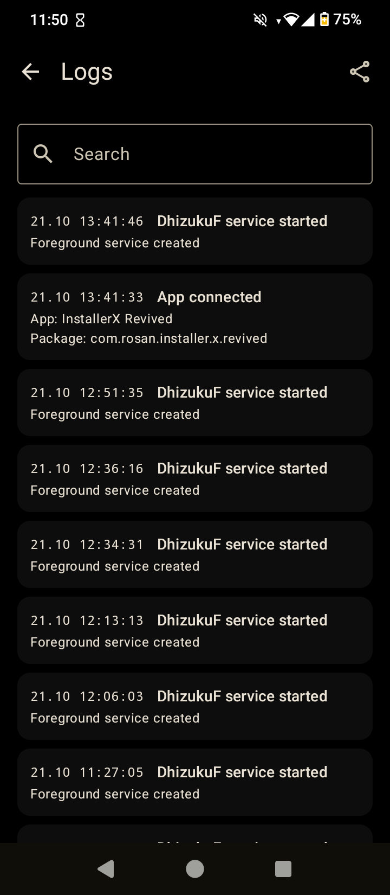

# DhizukuF

[](https://github.com/AmakerGame/DhizukuF/releases)
[](https://github.com/AmakerGame/DhizukuF/releases/latest)
[](LICENSE)
[](https://github.com/AmakerGame/DhizukuF/actions)
[](https://dhizukuf.en.uptodown.com/android)

**DhizukuF** is a fork of [Dhizuku](https://github.com/iamr0s/Dhizuku) that shares Android **Device Owner** permissions with other apps. On top of upstream Dhizuku, it adds **`dish`** — a Device Owner console for any terminal (Termux, `adb shell`, or any shell app), similar to how `rish` works for Shizuku.

| | |
| --- | --- |
| Package | `com.EdS.DhizukuF` |
| Version | See [`version.properties`](version.properties) |
| Android | 8.0 and newer |
| License | [GNU GPL v3](LICENSE) |

> [!NOTE]
> This is an unofficial fork. It is not affiliated with the original Dhizuku project or its author.
> The original README is kept as [docs/README_ORIGINAL.md](docs/README_ORIGINAL.md).

## Features

Compared to upstream Dhizuku (full list in [CHANGELOG.md](CHANGELOG.md)):

- **dish terminal** — run Device Owner commands from any shell. Export two files from the *Terminal (dish)* card and use them anywhere. See [docs/DISH.md](docs/DISH.md).
- **~50 dish commands** — apps (hide, suspend, block uninstall, permissions, clear data), restrictions, camera, screen capture, keyguard, ADB, private DNS, settings, and more.
- **Direct API** — `dish api METHOD ARGS…` calls public `DevicePolicyManager` methods (and other system managers) by name, with typed arguments and no rebuild.
- **Clear answers** — every command ends with `OK: …` or `NOT DONE: …` and a reason; changes are verified by reading values back.
- **Device Owner / Profile Owner aware** — dish works in both modes; commands that need full Device Owner say so clearly in Profile Owner mode.
- **Dangerous commands off by default** — a Settings switch gates risky actions for dish and the Dhizuku API.
- **Android TV** — launcher banner, D-pad / remote navigation with a visible focus indicator.
- **Compatibility Hub** — optional companion APK so clients built for the original Dhizuku package can talk to DhizukuF.
- **Customization** — theme (including AMOLED), app name and icon (chosen independently), “remember for updates”, and a pencil on the home screen to reorder or hide cards. See [docs/CUSTOMIZATION.md](docs/CUSTOMIZATION.md).
- **Logs** (off by default) — journal of service events, permissions, commands and errors, with search, categories, size limit and text export. See [docs/LOGS.md](docs/LOGS.md).
- **Safe start** — dish checks access before the interactive prompt; if dish is off, DhizukuF is not Device Owner, or access is refused, the console does not start.
- **Enable dish** — independent of **Enable Dhizuku** in Settings.
- **Terminal approval** — terminals appear in *App management* (e.g. `Termux (dish)`); optional advanced confirmation with Block, and *Show dish* label.

## Screenshots

```html
<!-- All sources are 720×1650; same width keeps them equal on GitHub. -->
<p align="center">

…

</p>
```

## Quick start

1. Make DhizukuF the **Device Owner**…
2. **Terminal (dish)** → **Export dish files**
3. Run from a terminal (`dish`, `help`, `hide`, …)
4. First run → approval in DhizukuF

## Download

| Source | Link |
| --- | --- |
| **Uptodown** (store page, easy install) | [dhizukuf.en.uptodown.com](https://dhizukuf.en.uptodown.com/android) |
| **GitHub Releases** (APK / notes) | [Latest release](https://github.com/AmakerGame/DhizukuF/releases/latest) |

Prefer Uptodown for a simple **Download** button. Use GitHub for release notes, tags, and CI artifacts.

## Building

```sh
./gradlew assembleRelease
./dish-client/build.sh
```
